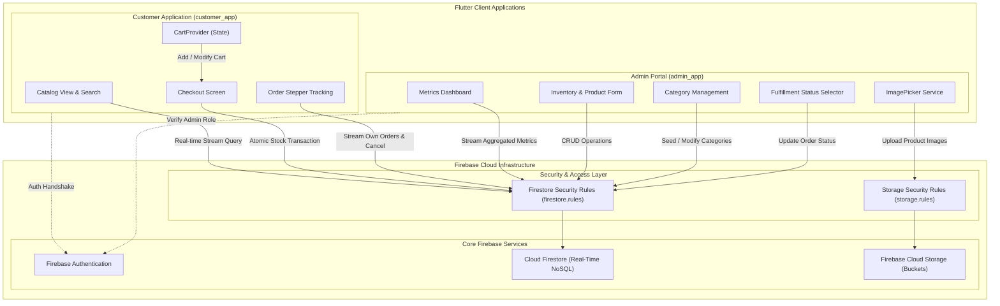

# Flutter Dual E-Commerce Platform

A production-ready dual-application e-commerce architecture featuring dedicated **Customer** and **Admin** Flutter applications powered by a single, shared **Firebase** backend.


---

## Overview

This repository contains a full-stack e-commerce solution engineered as two decoupled Flutter applications (`customer_app` and `admin_app`) interfacing with a centralized Google Firebase backend project. 

The system solves the operational divide between customer-facing storefronts and store management back-offices:
- **Customer Storefront (`customer_app`)**: Provides shoppers with a responsive shopping experience featuring live product search, category browsing, reactive cart management, atomic inventory checkout, and step-by-step order tracking.
- **Admin Management Portal (`admin_app`)**: Empowers store operators with real-time operational analytics (revenue, order counts, product inventory counts), catalog and category authoring, media uploads via Firebase Storage, and fulfillment status updates.
- **Shared Firebase Core**: Synchronizes catalog changes, stock deductions, and fulfillment updates across both clients with sub-second latency via Cloud Firestore real-time streams, fortified by role-based Cloud Firestore Security Rules and atomic transaction boundaries.

---

## Features

### Customer Storefront (`customer_app`)
- **Authentication & Identity**:
  - Secure email/password customer registration and login via Firebase Authentication.
  - Automatic Firestore user profile initialization (`users` collection) with `customer` role assignment.
  - One-click demo customer credentials helper for rapid environment verification.
- **Product Discovery & Browsing**:
  - Real-time catalog feed driven by Cloud Firestore stream subscriptions (`products` collection).
  - Dynamic client-side search bar filtering by product title, brand, and description.
  - Category navigation bar with active category filtering and product count indicators.
  - Stock badge indicators dynamically highlighting stock status (*In Stock*, *Low Stock*, *Out of Stock*).
- **Product Details & Stock Validation**:
  - High-resolution product image gallery preview, price display, and category attribution.
  - Interactive quantity stepper strictly constrained by real-time inventory limits.
- **Reactive Shopping Cart**:
  - Centralized cart state management powered by `provider` (`CartProvider`).
  - Badge notifications dynamically updating total item quantities across top and bottom navigation bars.
  - Increment, decrement, individual item removal, and bulk cart clearing.
  - Instant recalculation of line-item sub-totals and aggregate order value.
- **Checkout & Atomic Ordering**:
  - Multi-field checkout form validation capturing customer name, phone number, and delivery address.
  - Payment method selection interface (Cash on Delivery / Card placeholder).
  - Atomic stock deduction executed via Cloud Firestore transactions (`runTransaction`), preventing overselling during concurrent checkout attempts.
- **Order Tracking & Lifecycle**:
  - Real-time customer order stream displaying past and active purchases.
  - 4-stage tracking progress stepper: `Pending` → `Processing` → `Shipped` → `Delivered`.
  - Self-service order cancellation updating order status in compliance with security rule constraints.

### Admin Management Portal (`admin_app`)
- **Role-Gated Authentication**:
  - Restricted administrative sign-in verifying user UID against Firestore `users` document (`role == 'admin'`).
  - Route-level security via `AuthGate` preventing unprivileged access to administrative controls.
  - Hardened authentication flow requiring pre-provisioned administrator role credentials.
- **Real-Time Operational Dashboard**:
  - Live metric summary grid tracking total revenue (excluding cancelled orders), total orders placed, published products count, and active categories.
  - Dynamic stream listeners refreshing dashboard statistics without manual page reloads.
  - Quick-navigation cards to Inventory, Categories, and Orders.
- **Inventory & Product Management**:
  - Complete CRUD operations for products (Title, Description, Category, Price, Stock).
  - Integrated image picker supporting device gallery and camera captures.
  - Direct media upload pipeline to Firebase Storage with automatic download URL generation.
  - Fallback curated stock photography presets for rapid product seeding.
  - Product search filter and safe deletion confirmation dialogs.
- **Category Taxonomy Management**:
  - Automated initial database seeding with default retail categories (*Electronics*, *Fashion*, *Home*, *Beauty*, *Sports*).
  - Custom category creation and editing modal supporting unique category slugs, display names, and descriptions.
- **Order Fulfillment & Dispatch**:
  - Comprehensive order monitoring stream displaying all system-wide transactions sorted by date.
  - Order details inspection with complete buyer profile, contact telephone, delivery address, and line-item breakdown.
  - Live order status transition selector (`Pending`, `Processing`, `Shipped`, `Delivered`, `Cancelled`).

### Backend Security & Data Integrity
- **Declarative Firestore Security Rules (`firestore.rules`)**:
  - Role-based access control protecting `users`, `categories`, `products`, and `orders`.
  - Customers can read and create their own orders, and are strictly restricted to updating only the `status` field for cancellations (`diff(resource.data).affectedKeys().hasOnly(['status'])`).
  - Store catalog write permissions restricted strictly to administrators.
- **Storage Rules (`storage.rules`)**:
  - Public read access for store imagery with authenticated write access for administrative image uploads.

---

## Screenshots / Preview

*Static preview images are not currently stored in the repository. Both applications can be launched simultaneously in local development environments for complete visual evaluation.*

### Local Web Previews
When running via Flutter Web on standard local ports:
- **Admin Management Portal**: Hosted locally on `http://localhost:5000`
- **Customer Storefront**: Hosted locally on `http://localhost:5001`

---

## Tech Stack

| Domain | Technology / Package | Version / Source | Purpose |
|---|---|---|---|
| **Framework** | Flutter | SDK `^3.12.2` | Cross-platform UI toolkit targeting Mobile (Android/iOS) and Web |
| **Language** | Dart | `^3.12.2` | Core programming language for client logic and state management |
| **Backend / BaaS** | Google Firebase | Cloud Services | Serverless infrastructure, authentication, database, and storage |
| **Authentication** | `firebase_auth` | `^6.7.0` | User account lifecycle, credentials validation, and session auth tokens |
| **Database** | `cloud_firestore` | `^6.10.0` | NoSQL document database providing real-time data streaming and transactions |
| **Media Storage** | `firebase_storage` | `^13.6.0` | Cloud bucket storage for product photography and assets |
| **State Management** | `provider` | `^6.1.5+1` | Reactive application state handling for user auth and shopping cart |
| **Media Handling** | `image_picker` | `^1.2.3` | Native camera and photo library image picker in the Admin portal |
| **Date & Currency** | `intl` | `^0.20.3` | Timestamp formatting, date display, and financial number calculations |
| **UI Components** | Flutter Material 3 | `useMaterial3: true` | Modern Material Design components, dynamic color scheme, and typography |
| **Code Quality** | `flutter_lints` | `^6.0.0` | Recommended static analysis rules for Dart and Flutter |

---

## Project Architecture

The platform implements a **Dual-Client, Single-Backend Hub-and-Spoke Architecture**. Both Flutter clients operate independently with distinct bundle identifiers, dependency graphs, and view hierarchies, yet share identical domain data models and communicate via real-time WebSocket channels with Google Firebase.

### System Flow Diagram



### Architectural Communication Flows

1. **Product Publishing Cycle**:
   - The Store Administrator drafts a product in `admin_app`, optionally capturing an image with `image_picker`.
   - The image is uploaded to `firebase_storage`, resolving a secure public download URL.
   - The product document is written to the `products` collection in Firestore.
   - In `customer_app`, the active `StreamBuilder` listening to `products` immediately triggers a reactive UI rebuild, displaying the new item without requiring customer refresh.

2. **Atomic Checkout & Inventory Sync**:
   - The customer reviews items in `CartProvider` and initiates checkout in `customer_app`.
   - A Firestore transaction (`runTransaction`) validates and deducts each item's stock count in `products` while creating a new document in `orders`.
   - The `admin_app` dashboard stream instantly updates total order count, recalculates live revenue, and reflects lowered stock levels.

3. **Live Fulfillment Tracking**:
   - The Administrator views the order in `admin_app` and transitions the status (e.g., from `Pending` to `Processing` or `Shipped`).
   - The `customer_app` order details screen listens to the specific order stream, updating the tracking stepper and status badge instantaneously.

---

## Cloud Firestore Schema

| Collection | Document ID | Key Fields | Read Access | Write Access |
|---|---|---|---|---|
| `users` | User UID | `uid`, `name`, `email`, `role` (`'admin'` \| `'customer'`), `createdAt` | Document Owner or Admin | Document Owner (Create), Admin/Owner (Update) |
| `categories` | Category Slug | `id`, `name`, `description`, `icon` | Public | Admin Only |
| `products` | Auto-generated ID | `id`, `title`, `description`, `price`, `imageUrl`, `category`, `stock`, `createdAt` | Public | Admin Only |
| `orders` | Auto-generated ID | `id`, `userId`, `customerName`, `customerEmail`, `customerPhone`, `customerAddress`, `items` (Array), `totalAmount`, `status`, `createdAt` | Order Owner or Admin | Owner (Create & status-only update), Admin (All updates & deletion) |

---

## Directory Structure

```text
First_database/
├── firebase.json                   # Firebase deployment rules configuration
├── firestore.rules                 # Cloud Firestore security rules
├── storage.rules                   # Firebase Storage access rules
├── .env.example                    # Global environment variables template
├── config.example.json             # Configuration template for external services
│
├── customer_app/                   # Customer Storefront Application
│   ├── lib/
│   │   ├── models/                 # CategoryModel, ProductModel, OrderModel, CartItemModel
│   │   ├── providers/              # CartProvider (reactive shopping cart state)
│   │   ├── screens/                # Home, Categories, Product Detail, Cart, Checkout, Orders, Profile
│   │   ├── services/               # AuthService, FirestoreService
│   │   ├── firebase_options.dart   # Firebase client configuration
│   │   └── main.dart               # Entrypoint, theme configuration, and AuthGate
│   ├── android/                    # Android native project and google-services.json
│   ├── pubspec.yaml                # Customer app dependencies
│   └── README.md
│
└── admin_app/                      # Admin Management Portal Application
    ├── lib/
    │   ├── models/                 # CategoryModel, ProductModel, OrderModel
    │   ├── screens/                # Dashboard, Products, Add/Edit Product, Categories, Orders
    │   ├── services/               # AuthService, FirestoreService, StorageService
    │   ├── firebase_options.dart   # Firebase client configuration
    │   └── main.dart               # Entrypoint, theme configuration, and role-checked AuthGate
    ├── android/                    # Android native project and google-services.json
    ├── pubspec.yaml                # Admin portal dependencies and image_picker
    └── README.md
```

---

## Getting Started

### Prerequisites
- [Flutter SDK](https://docs.flutter.dev/get-started/install) (`^3.12.2` or higher)
- [Dart SDK](https://dart.dev/get-dart)
- An active [Google Firebase](https://console.firebase.google.com/) project with **Authentication**, **Cloud Firestore**, and **Firebase Storage** enabled
- Google Chrome (for Web testing) or an Android/iOS emulator

### 1. Repository Setup
Clone the repository and inspect the directory structure:
```bash
git clone https://github.com/shariarhossaintanvir/First_database.git
cd First_database
```

### 2. Environment & Firebase Configuration
Copy the sample environment configuration templates:
```bash
# In repository root
cp .env.example .env
cp config.example.json config.local.json

# In individual apps
cp customer_app/.env.example customer_app/.env
cp admin_app/.env.example admin_app/.env
```

Ensure your Firebase credentials (`firebase_options.dart` and `android/app/google-services.json`) are configured in both `customer_app/` and `admin_app/`.

### 3. Deploy Firebase Rules
Deploy the declarative security rules to your Firebase project using the Firebase CLI:
```bash
firebase deploy --only firestore:rules,storage
```

### 4. Running Both Applications Concurrently

Execute the two Flutter applications in separate terminal windows on distinct ports:

#### Terminal 1 — Run the Admin Portal
```bash
cd admin_app
flutter pub get
flutter run -d chrome --web-port=5000
```

#### Terminal 2 — Run the Customer Storefront
```bash
cd customer_app
flutter pub get
flutter run -d chrome --web-port=5001
```

*(You can also target physical mobile devices or emulators using standard device flags like `-d android` or `-d ios`.)*

---

## Testing & Access Controls

### Administrator Access (`admin_app`)
- Store operators must be provisioned with authorized administrative credentials in Firebase Authentication and a corresponding Firestore `/users/{uid}` document with `role: 'admin'`.
- Access is restricted exclusively to authorized administrative accounts.

### Customer Access (`customer_app`)
- **Email**: `customer@ecommerce.com`
- **Password**: `password123`
- *Helper*: The Customer login screen includes a **"1-Click Demo Customer Login"** button or allows direct self-registration with any email address.